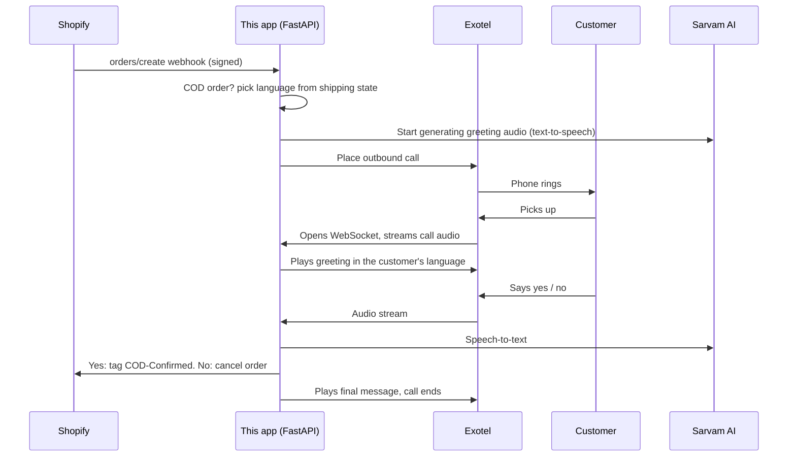

# COD Order Confirmation Calls

Automatically phone customers who place a **Cash on Delivery (COD)** order on Shopify, ask them in their **own language** whether they want to confirm the order, and then confirm or cancel the order based on what they say.

Built with **FastAPI**, **Exotel** (telephony), **Sarvam AI** (Indian-language speech-to-text and text-to-speech) and the **Shopify Admin API**.

> **Status:** working prototype. The confirm path has been run end to end on a Shopify development store. Test the cancel, retry and multi-language paths yourself before using it on real customer orders (see [Testing](#testing)).

## How it works



### Rules

| Situation | What happens |
|---|---|
| Customer clearly says **yes** | Order is tagged `COD-Confirmed` |
| Customer clearly says **no** | Order is cancelled |
| Answer is unclear, or silence | The question is repeated **once** |
| Still unclear after the repeat | Order is **cancelled** |
| Customer does not pick up, or hangs up before deciding | The app calls **again once** (after a delay). If that attempt also fails, the order is **cancelled** |
| A technical error (Exotel, Sarvam or Shopify API failure) | Logged, and the order is **never cancelled** because of it |

Both kinds of failed attempt (no answer and early hang-up) share the same 2-attempt limit. The greeting says the store name, the first product's name, and the order total.

### Languages

The call language comes from the **state of the order's shipping address**:

| Shipping address | Language |
|---|---|
| Gujarat | Gujarati (`gu-IN`) |
| Maharashtra | Marathi (`mr-IN`) |
| West Bengal | Bengali (`bn-IN`) |
| Tamil Nadu | Tamil (`ta-IN`) |
| Andhra Pradesh, Telangana | Telugu (`te-IN`) |
| Karnataka | Kannada (`kn-IN`) |
| Kerala | Malayalam (`ml-IN`) |
| Punjab | Punjabi (`pa-IN`) |
| Odisha | Odia (`od-IN`) |
| Outside India | English (`en-IN`) |
| India, but state missing or not listed above | Hindi (`hi-IN`) |

The mapping lives in `app/languages.py`. The spoken texts are in `app/messages.py` and the recognised yes/no words are in `app/intent.py`.

> **Translations need review.** The spoken scripts and yes/no word lists were written with AI help and have not been checked by native speakers. Have a native speaker of each language review them before using them with real customers.

## Prerequisites

- Python 3.11 or newer
- A Shopify store (a development store is fine) with **Cash on Delivery** enabled
- An [Exotel](https://exotel.com) account with outbound calling and the **Voicebot applet** (the applet appears only after KYC is complete)
- A [Sarvam AI](https://www.sarvam.ai) API key
- [ngrok](https://ngrok.com) (or any way to expose your local server over HTTPS and WSS)

## Setup

### 1. Install

```bash
git clone https://github.com/Paavan05/Shopify_COD_Order_Confirmation_Calls.git
cd Shopify_COD_Order_Confirmation_Calls
python -m venv .venv
source .venv/bin/activate          # Windows: .venv\Scripts\activate
pip install -r requirements.txt
```

### 2. Configure

```bash
cp .env.example .env
```

Fill in every value. See [Configuration](#configuration) below and [Getting the credentials](#getting-the-credentials) for where each one comes from. **Never commit `.env`**; it is already listed in `.gitignore`.

### 3. Start the server and a public tunnel

Terminal 1, from the project root (not from inside `app/`):

```bash
uvicorn app.main:app --port 8000
```

Terminal 2:

```bash
ngrok http 127.0.0.1:8000
```

Copy the `https://....ngrok-free.dev` address ngrok prints. This is your public host. Put it in `.env` as `PUBLIC_BASE_URL` (no trailing slash) and restart uvicorn.

To check the tunnel, open `https://<public-host>/docs`. You should see FastAPI's docs page.

### 4. Connect Shopify

In Shopify admin go to **Settings → Notifications → Webhooks**, click **Create webhook** and set:

- **Event:** Order creation
- **Format:** JSON
- **URL:** `https://<public-host>/webhooks/shopify/orders-create`

After saving, Shopify shows a signing secret under the webhook list. Copy it into `SHOPIFY_WEBHOOK_SECRET`.

### 5. Connect Exotel

In the Exotel dashboard:

1. Open **Manage → App Bazaar** and create a new flow.
2. Drag the **Voicebot** applet onto the canvas. Set its URL to `wss://<public-host>/ws/voicebot`.
3. Add a **Hangup** applet after it, then save and publish the flow.
4. Copy the flow's App ID into `EXOTEL_FLOW_APP_ID`. It is shown in the flow list and in the editor URL, which looks like `.../exoml/start_voice/12345`.

Whenever your ngrok address changes, update both the Shopify webhook URL and the Exotel Voicebot URL (a free static ngrok domain avoids this).

## Configuration

| Variable | Description |
|---|---|
| `PUBLIC_BASE_URL` | Public https address of this server, no trailing slash. Used for Exotel's call-status callback |
| `SHOPIFY_SHOP_DOMAIN` | Your store's `*.myshopify.com` domain |
| `SHOPIFY_ACCESS_TOKEN` | Admin API token with `read_orders` and `write_orders` |
| `SHOPIFY_WEBHOOK_SECRET` | Signing secret used to verify webhooks |
| `SHOPIFY_API_VERSION` | Shopify API version. Use a currently supported one |
| `STORE_NAME` | Store name spoken in the greeting |
| `EXOTEL_ACCOUNT_SID` | Exotel account SID |
| `EXOTEL_API_KEY`, `EXOTEL_API_TOKEN` | Exotel API credentials |
| `EXOTEL_SUBDOMAIN` | `api.exotel.com` or `api.in.exotel.com`, depending on your account's cluster |
| `EXOTEL_EXOPHONE` | Your Exotel virtual number, used as the caller ID |
| `EXOTEL_FLOW_APP_ID` | ID of the flow containing the Voicebot applet |
| `SARVAM_API_KEY` | Sarvam AI API key |
| `SARVAM_TTS_MODEL` | Sarvam text-to-speech model (default `bulbul:v3`) |
| `SARVAM_TTS_SPEAKER` | Sarvam voice (default `priya`). The Hindi, Marathi and Punjabi scripts use feminine wording, so use a female voice, or edit `messages.py` |

Behaviour settings (retry count and delay, repeat limit, silence detection) are constants in `app/config.py`.

## Getting the credentials

**Shopify access token.** Shopify's app-creation flow has changed. If you have an existing legacy custom app, open it under **Settings → Apps and sales channels → Develop apps** and reveal the Admin API token (shown once). Otherwise create an app in the Shopify **Dev Dashboard**, add the `read_orders` and `write_orders` scopes, install it on your store and obtain a token through the authorization step described in Shopify's documentation. Tokens from some Dev Dashboard flows expire after 24 hours, and this app reads a single static token from `.env`.

**Shopify webhook secret.** For a webhook created in the store admin, it is the string printed under the webhook list. For a webhook registered by your own app, it is the app's client secret.

**Exotel.** The account SID, API key, API token and subdomain are in the dashboard's API settings. The ExoPhone is under **Manage → ExoPhones**.

**Sarvam.** Create an API key in the Sarvam dashboard.

## Testing

1. Make sure uvicorn and ngrok are both running, and open ngrok's request viewer at `http://127.0.0.1:4040`.
2. Place a COD order on your store using **your own phone number**.
3. In the ngrok viewer, check the response to `POST /webhooks/shopify/orders-create`:
   - `200 accepted`: working
   - `200 ignored (not COD)`: your payment method's name does not match `COD_KEYWORDS` in `app/config.py`
   - `401`: wrong webhook secret
4. Your phone should ring. Test each outcome with a separate order: say yes, say no, stay silent or say something unrelated twice, ignore the call, and hang up during the greeting.
5. Test languages by changing the shipping state (for example Gujarat, Tamil Nadu, Delhi).

### Speed

The greeting audio is generated while the phone is still ringing so it is ready when the customer answers, and the other phrases are prepared while the greeting plays. 

## Troubleshooting

| Symptom | Likely cause and fix |
|---|---|
| `ModuleNotFoundError: No module named 'app'` | Run `uvicorn app.main:app` from the project root, and make sure the Python files are inside an `app/` folder |
| `ImportError: attempted relative import` | You ran `uvicorn main:app`. Use `app.main:app` |
| `Missing required env var: ...` | The value is empty or misspelled in `.env`. The file must be named `.env` |
| ngrok page `ERR_NGROK_8012` | uvicorn is not running, or listens on IPv4 only. Start uvicorn, then run `ngrok http 127.0.0.1:8000` |
| Webhook returns `401` | The signing secret in `.env` does not match Shopify's. Re-copy it and restart |
| Exotel `403 Forbidden` | IP whitelisting is on and your IP is not allowed, the subdomain is wrong for your cluster, or the account has restrictions. Read the response body printed in the log |
| Exotel `400 ... StatusCallbackEvents` | Do not send that field. This project sends only `StatusCallback` |
| Sarvam `400 Bad Request` | The model, speaker or language is not accepted. The log prints Sarvam's error text |
| Phone rings but nothing is spoken | Check the Voicebot URL in the Exotel flow, that the flow is published, and the Sarvam errors in the log |
| Bot never hears the answer | Lower `SPEECH_RMS_THRESHOLD` in `app/config.py` and check the `heard=` log lines |

## Project structure

```
.
├── app/
│   ├── main.py        # webhooks, call attempts, retries, Exotel status callback
│   ├── session.py     # one phone call: speak, listen, decide, act
│   ├── languages.py   # shipping state -> call language
│   ├── messages.py    # everything the bot says, per language
│   ├── intent.py      # yes / no / unclear recognition, per language
│   ├── speech.py      # Sarvam speech-to-text and text-to-speech (with prefetching)
│   ├── shopify.py     # webhook verification, COD check, confirm and cancel
│   ├── exotel.py      # outbound call API
│   └── config.py      # settings loaded from .env
├── measure_tts.py     # times Sarvam text-to-speech
├── requirements.txt
└── .env.example
```

## Limitations

- **Call state is kept in memory.** Restarting the server loses pending retries. Use a database or queue before going to production.
- **Phone numbers are assumed to be Indian.** The app keeps the last 10 digits and adds `+91`, so customers with foreign numbers would be dialled incorrectly. Calling abroad also needs international calling enabled on your Exotel account.
- **Confirmation is a tag.** Shopify has no "confirmed" order status, so confirming adds the tag `COD-Confirmed`.
- **Speech detection is simple.** It uses a loudness threshold, so noisy lines can be misheard. Because unclear answers end in cancellation, review the `heard=` log lines on real calls before going live.
- **Compliance.** Outbound calling in India is regulated (TRAI rules such as DND scrubbing, calling hours and DLT registration). Check what applies to transactional calls like these with Exotel before using this commercially.
- **Exotel and Sarvam details can change.** The Voicebot message format, status-callback fields, and Sarvam model and speaker names were written from their documentation and should be re-checked against the current docs.
